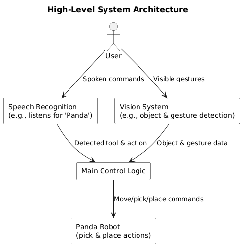
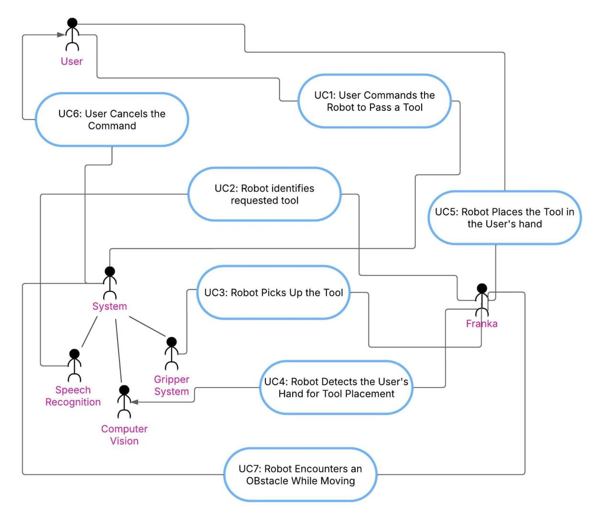

# Human-to-Robot Interaction

Human Intention Recognition for Human-Robot Interaction — a ROS-based system that lets a **Franka Emika Panda** robot understand spoken commands and hand gestures to pick up, hand over, and place tools.

A user says something like *"Panda, pass me the wrench"*. The robot listens for the trigger word, classifies the requested tool and action, locates the tool with a camera, picks it up, and hands it to the user's open palm — or takes it back when asked.

> Developed for module CE903 (University of Essex) by Group #2: Claudia Isabela Arciénega Martínez, Carlo Felipe Vivanco Coronado, Gilberto Velasco Castro, Can Koçyiğitoğlu, Santiago Quihui Rubio, Paul Rodrigo Verdugo Treviño, and Valentina Vizcaino Martínez. Supervised by Dr. Weiyong Si.

## Architecture

Spoken commands and hand gestures feed two independent modules — Speech Recognition and Vision — whose outputs are combined by the Main Control Logic, which drives the robot and returns it to idle once a task is complete.



## Use cases

The main interaction flow is broken down into cooperating use cases across the user, the system, and the robot (Franka):



- **UC1** — User commands the robot to pass a tool
- **UC2** — Robot identifies the requested tool
- **UC3** — Robot picks up the tool
- **UC4** — Robot detects the user's hand for tool placement
- **UC5** — Robot places the tool in the user's hand
- **UC6** — User cancels the command
- **UC7** — Robot encounters an obstacle while moving

## How it works

1. **Speech recognition** (`vision_sim/cli/combine.py`) listens continuously for the trigger word "panda", transcribes the command with Google Speech Recognition, and uses a zero-shot BART-large-MNLI classifier to extract the requested **tool** and **action** from natural language.
2. **Vision** (`vision_sim/vision_server/main.py`) runs a YOLO model to detect and localize tools in the camera feed, and MediaPipe to track the user's hand landmarks, gesture (e.g. open palm), and pointing direction. Object orientation is estimated with OpenCV contour analysis + PCA.
3. **Robot control** (`panda_class.py`) publishes Cartesian targets on ROS 2 topics to move the end-effector, open/close the gripper, and convert between camera, world, and robot coordinate frames.
4. **Integration** (`sim.py`) ties the three modules together: once a tool and action are recognized, it looks up the tool's position from the vision module, converts it to world coordinates, and drives the robot through pick-and-place or hand-to-hand transfer.

## Project structure

```
.
├── panda_class.py                   # Panda robot control class (rclpy / franka_ros2)
├── sim.py                           # Main integration script (speech + vision + robot)
├── requirements.txt
├── sim_ros2/                        # Gazebo launch file, world (with RGB-D camera) and controller config
└── vision_sim/
    ├── vision_server/
    │   ├── img_sub.py               # ROS <-> OpenCV image/depth bridge
    │   └── main.py                  # VisionClass: YOLO detection + gesture recognition
    └── cli/
        ├── combine.py               # Threaded speech-to-text + zero-shot tool/action classifier
        ├── voice.py                 # Standalone speech-to-text example
        └── llm.py                   # Standalone zero-shot classification example
```

## Requirements

- Ubuntu 24.04 + Python 3.12
- ROS 2 Jazzy (`ros-jazzy-desktop`), Gazebo Harmonic via `ros_gz`, and [`franka_ros2`](https://github.com/frankarobotics/franka_ros2) (`jazzy` branch)
- A CUDA-capable GPU is recommended for YOLO and the LLM classifier

## Installation

```bash
sudo apt install ros-jazzy-desktop ros-jazzy-ros-gz ros-jazzy-gz-ros2-control \
  ros-jazzy-ros2-control ros-jazzy-ros2-controllers portaudio19-dev python3-venv

mkdir -p panda_ws && cd panda_ws
git clone -b jazzy https://github.com/frankarobotics/franka_ros2.git src/franka_ros2
git clone https://github.com/carlovivanco/human-to-robot-interaction.git src/human-to-robot-interaction
vcs import src < src/franka_ros2/dependency.repos   # franka_description etc. (needs python3-vcstool)

source /opt/ros/jazzy/setup.bash
rosdep install --from-paths src --ignore-src --rosdistro jazzy -y --skip-keys=zed_wrapper
colcon build --cmake-args -DCMAKE_BUILD_TYPE=Release
source install/setup.bash

# system site-packages so the venv sees rclpy / cv_bridge
python3 -m venv --system-site-packages .venv && source .venv/bin/activate
pip install -r src/human-to-robot-interaction/requirements.txt
```

## Running the simulation

One command starts Gazebo (FR3 arm, table, the four tools, a 3D open hand, RGB-D camera), waits for the
controllers and runs `sim.py`; the other two modes also record:

```bash
scripts/record_demo.sh run       # just run
scripts/record_demo.sh screen    # + screen capture -> portfolio_export/raw/demo_screen.mkv
```

It finds the workspace by itself (or set `PANDA_WS`). When the terminal prints "press any key to start", press Enter
and say **"panda, pass me the hammer"** (or *wrench*, *screwdriver*, *pliers*). The arm picks the tool and holds it
over the open hand in the scene. Stop with Ctrl+C. For recording, convert the clip with
`python3 scripts/export_demo.py convert --input portfolio_export/raw/demo_screen.mkv --start <s> --duration 8`.

To start the pieces by hand: `ros2 launch sim_ros2/demo.launch.py` (add `DEMO_HEADLESS=1` for no window), then
`python3 sim.py` from the repo root.

How the arm is driven: Gazebo's `cartesian_impedance_example_controller` oscillates, so the arm is joint-position
controlled and `sim_ros2/ik_node.py` turns the Cartesian targets that `panda_class.py` publishes on
`/cartesian_impedance_example_controller/equilibrium_pose` into joint commands. The Panda ("fer") model is rejected by
Gazebo (invalid inertia), so the simulation uses the FR3, which has the same reach. The gripper is driven through a
`JointGroupPositionController` on `fr3_finger_joint1` (simulation only); on a real robot replace `Panda.set_gripper`
with the `franka_gripper` actions.

The hand is a 3D mesh (`sim_ros2/assets/hand/hand.glb`): the silhouette of a real open-palm photo
(`sim_ros2/assets/hand.png`, credit in `assets/CREDITS.txt`) inflated into a relief and textured with the photo, so
MediaPipe reads `Open_Palm`. Hands built from plain shapes were not recognised. Regenerate it with
`python3 scripts/make_hand_relief.py` (needs `trimesh`, `scipy`, `Pillow`).

## Training the tool detector

The weights are not in the repo. The detector is trained on simulation renders plus real photos (YOLO26, the newest
Ultralytics generation; `n` is the size that is practical on CPU, use `yolo26s.pt` with a working GPU):

```bash
python3 sim_ros2/make_dataset.py --n 400            # with the Gazebo demo running
python3 scripts/fetch_real_tools.py                 # Open Images photos (Hammer / Screwdriver / Wrench boxes)
YOLO_AUTOINSTALL=False python3 scripts/autolabel_pliers.py
YOLO_AUTOINSTALL=False yolo detect train data=vision_sim/data_all.yaml model=yolo26n.pt epochs=100 imgsz=640 device=cpu
cp runs/detect/train/weights/best.pt vision_sim/models/tools-100-epochs.pt
```

`YOLO_AUTOINSTALL=False` stops Ultralytics from pip-installing numpy 2 into the venv, which breaks `cv_bridge`.
Open Images has few boxed photos of these tools (about 200) and none of pliers: for the real arm, add 50+ photos of
your own tools taken with the environment camera.

Speech is transcribed locally with Whisper `large-v3-turbo` (`faster-whisper`, GPU if its CUDA libraries load, else
CPU int8, roughly 3.5 s per command on CPU). The first run downloads about 1.6 GB.

## Testing

The system was validated at unit, integration, sub-system, and full-system levels throughout development (see the project report for the full test log). Highlights:

- Voice-to-text tool name recognition: ~95% accuracy
- Object recognition on an unseen dataset: >90% accuracy
- Hand gesture classification on an unseen dataset: >95% accuracy
- Camera-to-robot coordinate conversion: positioning error within 5mm

## Project management

Development followed Agile/Scrum, with weekly sprints tracked in Jira and reviewed with the project supervisor, alongside test-driven development practices.
